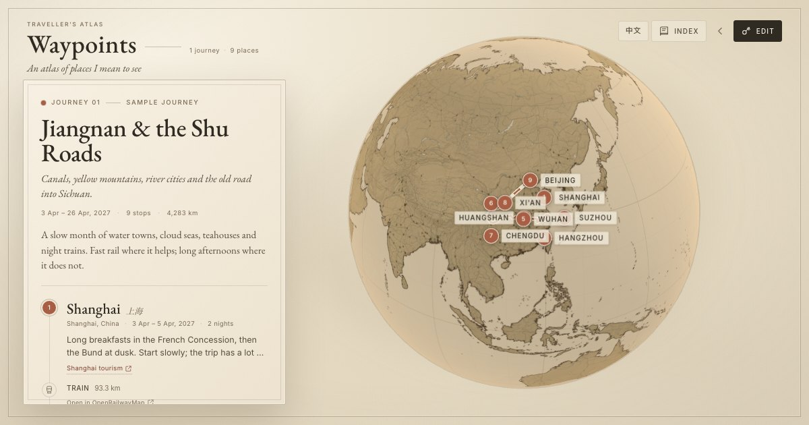

# Waypoints · 途迹

A bilingual, antique-globe travel wishlist. A freely rotating parchment globe, multiple journeys, real ground and rail paths, and a small editing relay that lets a handful of travel partners update the same public atlas.

- **Public site:** static, read-only, hosted on GitHub Pages at `https://waypoints.derekhan.link`
- **Editing:** a Cloudflare Worker verifies per-partner access keys and commits changes to this repository
- **Content:** one versioned JSON file with optional English and Chinese fields
- **Routes:** OSRM for roads, OpenRailRouting for railway tracks, Transitous for optional timetable examples, great-circle arcs for flights
- **Design:** beige paper, sepia geography from 1:10m Natural Earth vectors and shaded relief, EB Garamond, terracotta pins, no map tiles
- **Globe:** free trackball rotation, no fixed axis, scroll/pinch zoom, progressive 4K→8K basemap

The bundled sample is **江南与蜀道 / Jiangnan & the Shu Roads** — a nine-stop spring journey through China.



### Deployed here

| | |
|---|---|
| Repository | https://github.com/DerekHam/waypoints |
| Public site | https://waypoints.derekhan.link |
| Editing API | https://api.waypoints.derekhan.link |
| Worker fallback URL | https://waypoints-api.derekham.workers.dev |

The `VITE_API_BASE` Actions variable points at the API custom domain. The API domain is a Cloudflare Workers custom domain; it is managed in Cloudflare rather than `wrangler.toml`, so recreate it if the Worker itself is ever recreated. Route/station/timetable caching and login rate limiting use the `WAYPOINTS_KV` namespace bound in `wrangler.toml`.

---

## Quick start

```bash
npm install
npm run dev
```

Open <http://localhost:5173>. The sample atlas is in `public/data/atlas.json`; all public content is static.

Useful commands:

```bash
npm run build       # type-check + production build
npm run preview     # preview the production build
npm test            # unit tests
npm run validate    # validate the atlas JSON with the shared schema
npm run keygen -- "Derek"   # generate a partner access key
npm run keygen -- --name "Derek" --key "a long passphrase"  # or choose your own
npm run routes      # re-compute route geometry for the sample
npm run globe:texture  # rebuild the detailed basemap (downloads Natural Earth data)
```

---

## The globe and its detail

The globe is not a fixed-axis model. Drag anywhere on it to rotate freely in any direction (including over the poles and with roll); use the scroll wheel or a pinch gesture to zoom. The view settles where you leave it — there is no idle auto-spin. Selecting a journey or stop eases the globe back to that place; you can then keep rotating freely.

The basemap is pre-rendered from public-domain Natural Earth data so it keeps the antique palette and stays fast:

- 1:10m land and coastlines
- country borders and 1:10m first-order subdivision borders
- major and secondary roads, plus railways
- rivers, lakes and large urban areas
- 1:50m shaded relief for terrain
- major populated places as small ink dots
- 10° and 30° graticules, paper grain and stains

It is drawn at **8192×4096** and downscaled to **4096×2048**. Browsers first receive the 4K image, then upgrade to 8K on desktop when the GPU and viewport are suitable. The zoom limit is deliberately tuned so the 8K basemap stays readable; this is an atlas, not a street-level tile map.

Regenerate the basemap with:

```bash
npm run globe:texture
```

The source data (Natural Earth shapefiles and the shaded-relief TIFF) is downloaded to `.globe-cache/`, which is ignored by git. Only the finished JPEGs in `public/globe/` are committed.

---

## How editing works

Public visitors never get a write path. Editing is enabled by a small relay in `worker/`:

1. The editor enters a long **access key** in the site.
2. The Worker verifies a SHA-256 hash of that key and issues a seven-day signed session token.
3. Saves go to the Worker, which validates the atlas schema, sets `updatedAt`/`lastEditedBy`, and commits `public/data/atlas.json` to this repository with a fine-grained GitHub token.
4. GitHub Actions rebuilds the public page. The editor sees their changes immediately; the public sees them in about a minute.

Saving uses the GitHub file SHA for optimistic concurrency. If someone saved first, the editor gets a conflict dialog: load the latest, overwrite, or download their copy. Nothing is silently clobbered.

Without a deployed Worker, the site still works. The unlock dialog offers a **local preview** mode that saves only to the browser — useful for trying the editor before setting up Cloudflare.

The atlas is public. Notes, dates and links are visible to everyone; don’t store booking references, private addresses, or personal documents.

---

## Deploy the static site

The repository is already configured for `DerekHam/waypoints` and `waypoints.derekhan.link`.

1. Create a public repository named `waypoints` under the `DerekHam` account (or change `src/config.ts`, `public/CNAME`, and `worker/wrangler.toml`).
2. Push this project to `main`.
3. In **Settings → Pages → Build and deployment**, set **Source** to **GitHub Actions**.
4. Push to `main` (or run **Deploy atlas to GitHub Pages** from the Actions tab). The workflow in `.github/workflows/deploy.yml` validates the data, runs tests, builds, and publishes `dist/`.
5. Under **Settings → Pages → Custom domain**, enter `waypoints.derekhan.link`. The repository already includes `public/CNAME`, which is copied into the build.
6. At your DNS provider for `derekhan.link`, add:

   ```
   Type   Name        Value
   CNAME  waypoints   derekham.github.io
   ```

   The hostname is a subdomain, so a CNAME is the right record. If you use an apex domain instead, use GitHub Pages’ A/AAAA records.
   If the domain is on Cloudflare, set the record’s proxy status to **DNS only** (grey cloud). An orange-cloud proxy can prevent GitHub from issuing the Pages certificate; you can enable the proxy again after the certificate is issued if you really need it.
7. Wait for the certificate, then enable **Enforce HTTPS**.

The built site uses a relative base, so it also works at `https://derekham.github.io/waypoints/` before the custom domain is live (GitHub may redirect once a custom domain is configured).

---

## Deploy the editing relay (Cloudflare Workers)

Shared editing needs a free Cloudflare account. The Worker holds the GitHub write token; it never reaches the browser.

### 1. Create a fine-grained GitHub token

In GitHub: **Settings → Developer settings → Personal access tokens → Fine-grained tokens → Generate new token**.

- Repository access: **Only select repositories** → `DerekHam/waypoints`
- Permissions: **Contents: Read and write** (Metadata read is automatic)
- Set an expiry you are comfortable with

Copy the token; it is used only as a Worker secret.

### 2. Log in and deploy

```bash
npx wrangler login
npx wrangler secret put GITHUB_TOKEN --config worker/wrangler.toml
# paste the fine-grained token

openssl rand -base64 48
npx wrangler secret put SESSION_SECRET --config worker/wrangler.toml
# paste the random value

npm run keygen -- "Derek"
# copy the generated JSON object
npx wrangler secret put EDITOR_KEYS --config worker/wrangler.toml
# paste a JSON array, e.g. [{"name":"Derek","salt":"…","hash":"…"}]

npm run worker:deploy
```

Wrangler prints the URL, normally:

```
https://waypoints-api.<your-cloudflare-subdomain>.workers.dev
```

`worker/wrangler.toml` already contains the repo, branch, atlas path and allowed site origins. Change `SITE_ORIGINS` if you use another domain.

### 3. Add optional caching and rate limiting (recommended)

The Worker works without storage, but KV makes it much better: route/station/timetable caching and login rate limiting.

```bash
npx wrangler kv namespace create WAYPOINTS_KV --config worker/wrangler.toml
```

Uncomment the `[[kv_namespaces]]` block in `worker/wrangler.toml` and paste the returned id, then redeploy.

### 4. Tell the site where the relay is

In GitHub: **Settings → Secrets and variables → Actions → Variables → New repository variable**

```
VITE_API_BASE = https://waypoints-api.<your-cloudflare-subdomain>.workers.dev
```

Re-run the Pages workflow (or push a commit). Alternatively set the value in `src/config.ts`.

The site’s CSP permits `https://*.workers.dev` out of the box. If you bind a custom API domain, add it to `connect-src` in `index.html`.

### 5. Test it

Open the site, click **Edit**, enter a generated key, add a place, check a rail connection, and save. The commit appears in the repository and the public page redeploys.

---

## Partners and keys

Keys are checked on the Worker, not in the browser. The browser’s access-key field simply submits whatever key you gave the editor; the key generator is the CLI below.

Generate a random key per person:

```bash
npm run keygen -- "Alex"
```

Or choose your own key/passphrase:

```bash
npm run keygen -- --name "Alex" --key "a long custom passphrase"
```

To keep the custom key out of shell history, let the script prompt for it:

```bash
npm run keygen -- --name "Alex" --key-stdin
```

Add the printed object to the `EDITOR_KEYS` array. The array is a Worker secret:

```json
[
  { "name": "Derek", "salt": "…", "hash": "…" },
  { "name": "Alex", "salt": "…", "hash": "…" }
]
```

The key itself is shown once at generation time. Give it to the partner through a password manager or another private channel. Keys can contain spaces and Unicode; leading/trailing spaces are trimmed.

- **Replacing a key:** replace that editor’s object in the array. Don’t leave the old object alongside the new one, or the old key will keep working.
- **Add someone:** add their entry, update the secret.
- **Revoke someone:** remove their entry, update the secret. Existing sessions remain valid for up to seven days. To end every session immediately, generate a new `SESSION_SECRET` and redeploy; everyone re-enters their key.
- **Security:** the Worker stores only a salted SHA-256 hash. Random keys are strongest. If you choose a custom key, use a long one — 20+ characters or four or more random words. A short custom key is easy to guess; login rate limiting helps but is not a substitute for entropy.
- GitHub commits are attributed in the message (`Atlas update by Alex`), even though all writes use the same repository token.

Local development uses the same API. Copy `worker/.dev.vars.example` to `worker/.dev.vars`, fill in a test key and secrets, run the Worker, and point the site at it:

```bash
npx wrangler dev --config worker/wrangler.toml
# in another terminal:
echo 'VITE_API_BASE=http://127.0.0.1:8787' > .env.local
npm run dev
```

`worker/.dev.vars` and `.env.local` are ignored by git.

---

## Content model

`public/data/atlas.json` is validated by the shared Zod schema in `shared/atlas.ts`.

```json
{
  "version": 1,
  "updatedAt": "2026-11-06T00:00:00.000Z",
  "lastEditedBy": "Derek",
  "journeys": [
    {
      "id": "jiangnan-shu-roads",
      "title": "Jiangnan & the Shu Roads",
      "titleZh": "江南与蜀道",
      "subtitle": "…",
      "subtitleZh": "…",
      "note": "…",
      "noteZh": "…",
      "color": "terracotta",
      "stops": [
        {
          "id": "shanghai",
          "name": "Shanghai",
          "nameZh": "上海",
          "region": "Shanghai",
          "regionZh": "上海",
          "country": "China",
          "countryZh": "中国",
          "lat": 31.2304,
          "lon": 121.4737,
          "arrive": "2027-04-03",
          "depart": "2027-04-05",
          "note": "…",
          "noteZh": "…",
          "links": [
            { "label": "Shanghai tourism", "labelZh": "上海旅游", "url": "https://…" }
          ]
        }
      ],
      "legs": [
        {
          "mode": "train",
          "route": {
            "provider": "openrailrouting",
            "points": [[121.4737, 31.2304], [120.5853, 31.2989]],
            "distanceKm": 93.3,
            "status": "routed"
          },
          "connection": null
        }
      ]
    }
  ]
}
```

Rules enforced by the schema:

- `legs.length` must be `stops.length - 1`.
- IDs are unique.
- Coordinates are valid latitude/longitude.
- Dates are `YYYY-MM-DD`, and departure cannot precede arrival.
- URLs must be `http(s)`.
- Up to 24 journeys and 80 stops per journey.

Optional `…Zh` fields are used when the interface is Chinese; if they are empty, the English/base value is shown. Chinese search results fill them automatically when the interface is in Chinese. You can always edit both fields from the editor.

---

## Routing

Routes are computed **only while editing** and stored in the atlas. Public views make no routing requests.

| Mode | Source |
|---|---|
| Train | OpenRailRouting (OSM railway tracks) |
| Car / bus | OSRM driving |
| Bike | OSRM bike |
| Walk | OSRM foot |
| Plane | Great-circle arc |
| Ferry | Schematic arc |

For rail, the Worker resolves the nearest principal station through the OpenRailwayMap facility API (with Photon as a fallback), routes between the stations, and adds short connectors back to the stop pins. This avoids snapping to disconnected sidings in city centres. Stations and routes are cached in KV for 30 days.

**Timetable examples:** on a train leg, the editor can choose a date and approximate local departure time. The Worker queries Transitous/MOTIS and returns up to three real connections. The chosen summary is stored with the journey, labelled as an example with the date it was checked. Coverage varies by region; the track path is always shown even when timetables are unavailable.

**Fair use:** OSRM’s FOSSGIS demo asks for ≤1 request/second and light use; OpenRailRouting and Transitous are community/demo services. The Worker caches results and only computes missing routes while editing. If you outgrow the demos, self-host OSRM/OpenRailRouting or swap the endpoints in `worker/src/index.ts`.

If a route cannot be computed, the leg keeps a dashed estimated line. Nothing about the public page breaks.

### Attribution

The site credits Natural Earth, OpenStreetMap contributors, OSRM, OpenRailRouting and Transitous in the itinerary footer. Keep those links if you reuse the project.

---

## Chinese support

- Interface switch in the top bar (`中文` / `EN`), persisted in the browser.
- Defaults to Chinese when the browser language is Chinese.
- `<html lang="zh-CN">`, Chinese date formatting, number formatting and distance units.
- Optional Chinese fields for journey titles, subtitles, notes, stop names, regions, countries and link labels.
- System CJK serif/sans stacks (Songti/PingFang, SimSun/Microsoft YaHei, Noto CJK) paired with self-hosted EB Garamond and Inter.
- Photon place search with Chinese queries; CJK names render in the globe pins and itinerary.
- Sample content is fully bilingual.

The Globe labels intentionally avoid uppercase/letter-spacing in Chinese; the CSS uses `:lang(zh)` adjustments.

---

## Project structure

```
public/
  data/atlas.json       the editable atlas
  globe/                pre-rendered 4K/8K antique basemaps
  CNAME, robots.txt, sitemap.xml, og.jpg, favicon.svg
shared/
  atlas.ts              Zod schema + bilingual content helpers
src/
  components/           globe, itinerary, editor, dialogs, search
  lib/                  API client, geo/time helpers, search, texture, drafts
  i18n.ts               English/Chinese UI strings
  store.ts              UI + atlas state, saving, conflicts
  styles.css            the paper/sepia design system
worker/
  src/index.ts          auth, GitHub commit relay, routing, timetables
  wrangler.toml
  .dev.vars.example
scripts/
  make-key.mjs          generate partner keys (random or custom)
  precompute-routes.mjs sample route geometry
  build-globe-texture.mjs  pre-render the detailed basemap
  validate-atlas.ts     validate the JSON
.github/workflows/
  deploy.yml            GitHub Pages
```

---

## Security notes

- The GitHub write token lives only in Cloudflare Worker secrets.
- Partner keys are high-entropy and stored as salted SHA-256 hashes; sessions are HMAC-signed and expire after seven days.
- The Worker only writes `public/data/atlas.json`, validates the schema and request size, and rate-limits logins/saves/routes when KV is enabled.
- CORS allows only the configured site origins. Non-browser clients still need a valid session token.
- There is no individual GitHub identity for editors; the per-person key provides attribution and revocation.
- The atlas is public by design. Treat notes and links as public information.
- Editing is intentionally turn-based: conflicts are detected by file SHA, but there are no live cursors or real-time merges.

## Limitations

- Shared editing depends on Cloudflare Workers; without it, the site is read-only and the editor is a browser-local preview.
- Rail geometry follows tracks, not passenger services; timetable examples can go stale and must be verified before booking.
- Ferry routes are schematic; border-crossing ground routes can be approximate or unavailable.
- Public changes wait for the GitHub Actions build (usually under a minute).
- The demo routing/timetable services are community-run and not guaranteed.

---

## Credits

Built by Derek. Basemap, coastlines, roads, relief and borders from [Natural Earth](https://www.naturalearthdata.com/) (public domain). Geocoding and route data © [OpenStreetMap](https://www.openstreetmap.org/copyright) contributors (ODbL). Routes by [OSRM](https://project-osrm.org/) and [OpenRailRouting](https://github.com/geofabrik/OpenRailRouting). Timetables by [Transitous](https://transitous.org/) / MOTIS. Typefaces: EB Garamond and Inter (SIL Open Font License).
